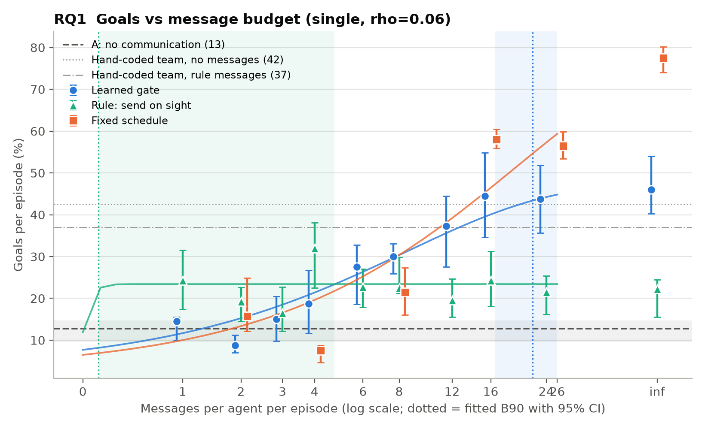
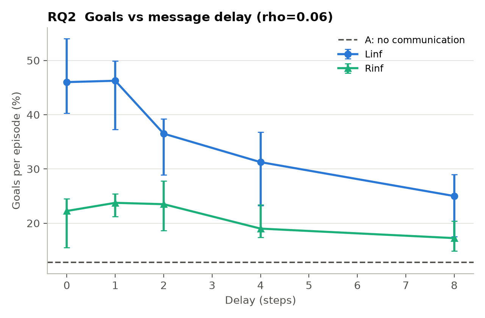
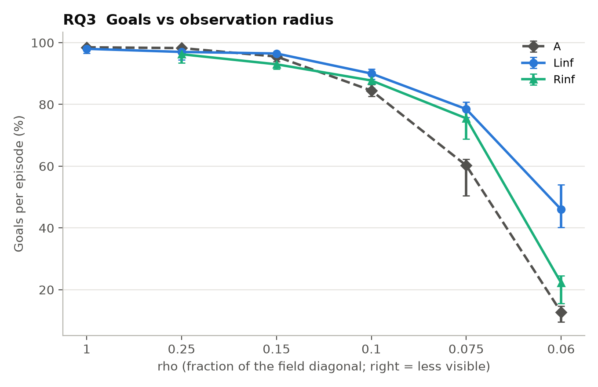
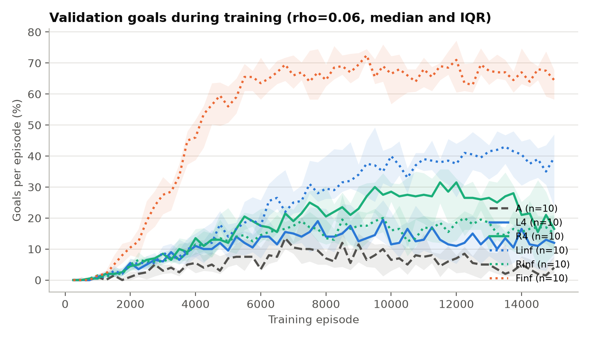

# MARL Rocket — Learning Communication-Efficient Coordination

> *How does limiting communication affect the ability of cooperative RL agents to learn effective coordination?*

A 2D two-agent soccer environment inspired by Rocket League, built to measure how many messages two
cooperative reinforcement-learning agents actually need. Each agent sees only a small radius around itself,
a goal only counts if the teammate assisted it, and the agents may send a limited number of messages per
episode ("here is where I see the ball"). We sweep the message budget, the delivery delay and the view radius
and find the **saturation point**: the budget beyond which extra messages stop helping.

Course project for CS 329: Foundations of AI — Multiagent Systems, IIT Gandhinagar.
**Report:** [report/report.pdf](report/report.pdf) (LaTeX source: [report/report.tex](report/report.tex)).
**Final results:** [checkpoints/sweep_v5/results.md](checkpoints/sweep_v5/results.md).

---

## What it does

* **Simulates a cooperative 2D soccer task** with partial observability, an assist rule and a budgeted,
  optionally delayed message channel (a custom Gymnasium environment).
* **Trains two independent Double-DQN agents** (fast NumPy MLPs; no deep-learning framework needed).
* **Learns *when* to send a message** with a message gate credited by counterfactual rollouts:
  the game is cloned, the message is delivered in one copy and withheld in the other, and the gate learns the
  difference in team reward.
* **Compares three senders** to separate the value of the information from learning when to send it:
  a fixed broadcast schedule, a hand-coded rule and the learned gate.
* **Runs pre-registered experiments**: the decision rules for a pilot study were fixed in advance, and
  the pilot chose the regime used by the main sweep (580 runs, 10 seeds per configuration).
* **Reports results with robust statistics**: medians and IQRs, Holm-corrected Mann–Whitney tests, bootstrap CIs and a fitted
  saturation budget *B₉₀*.

---

## How it works

### Environment
A 20 × 30 field with the goal at the top. Agents move (up, down, left, right, boost, noop) and dribble
the ball. An agent sees the ball and its teammate only within ρ × the field diagonal (ρ = 0.06 in the main
sweep, a radius of about 2 units), and remembers the last place it saw them. A goal counts only if the
teammate touched the ball within the last 40 steps, so the two agents have to find the ball and each other.

### Messages
A message carries the sender's current sighting of the ball, its position and its last touch. It arrives
after a delay δ and is shown to the receiver for 10 steps. A budget *B* limits each agent's
messages per episode.

| Setting | Sender |
|---|---|
| `A` | no communication |
| `F<B>` | fixed schedule: broadcast every ⌈T/B⌉ steps |
| `R<B>` | rule: send on sight when the teammate's copy of my last message has expired |
| `L<B>` | learned gate: decides when to spend the budget |

### Learning
Each agent is a Double DQN (3-step returns, 128-128 MLP, Polyak targets). The learned sender's gate is a
small regression network that sends when its score exceeds a per-message cost. It is trained on
counterfactual rollouts, a difference reward that uses only the team reward.

### Research questions
* **RQ1 — saturation:** where does team performance stop improving as the budget grows?
* **RQ2 — delay:** how much does a delivery delay hurt communication?
* **RQ3 — observability:** does communication matter more when agents see less?

---

## Results

Final results from the main sweep: 580 runs (58 configurations × 10 seeds) at ρ = 0.06, in the regime
chosen by a pre-registered pilot. Goal rate on 200 unseen episodes, median over seeds
([full results](checkpoints/sweep_v5/results.md)):

| Team | Goals % | Messages / agent / episode |
| :--- | :--- | :--- |
| No communication (`A`) | 12.8 | 0 |
| Rule sender, unlimited (`Rinf`) | 22.2 | 1.3 |
| Hand-coded team (no learning) | 42.5 | 0 |
| **Learned sender, unlimited (`Linf`)** | **46.0** | **4.3** |
| Fixed broadcast, every step (`Finf`) | 77.5 | 50.7 |

### RQ1: how many messages?
The learned sender saturates at an allowance of about 22 messages (B90 = 21.7, 95% CI 16.5–29.3) but
only ever sends about 4 per episode. The rule saturates at one message, but low. The fixed broadcast keeps
improving up to every step: it also reports the sender's position, which the event-triggered senders never
share.



### RQ2: delay
A one-step delay is harmless; eight steps cut the learned sender's gain by two thirds, but it still scores
twice as often as the silent team.



### RQ3: observability
The gain from communication grows steadily as the view shrinks: about 0 points at ρ ≥ 0.15, +18 at
ρ = 0.075 and +33 at ρ = 0.06.



### Training
Every communicating team learns faster and higher than the silent team, which peaks near 10% and then
degrades.



Full tables with tests and confidence intervals:
[checkpoints/sweep_v5/results.md](checkpoints/sweep_v5/results.md). More figures (send timing, budget
awareness) are in [checkpoints/sweep_v5/figures](checkpoints/sweep_v5/figures). The 1,213 development
runs before the main sweep, and why early versions showed no benefit from communication, are described in
the [report](report/report.pdf).

---

## Tech Stack

| Area | Tools & Libraries |
| :--- | :--- |
| **Environment** | Gymnasium, NumPy |
| **Learning** | NumPy (hand-written MLPs, backprop and Adam) |
| **Analysis** | Matplotlib; statistics implemented in NumPy |

---

## Running

```bash
# One training run (setting, view radius)
python -m experiments.train --setting L4 --obs_frac 0.06

# Pilot -> apply its pre-registered rules -> main sweep -> report
python -m experiments.run_all --sweep pilot --save_dir checkpoints/pilot_v6
python -m utils.report --dir checkpoints/pilot_v6 --pilot --apply
python -m experiments.run_all --sweep tier1      # then tier2, tier3, tier4
python -m utils.report --dir checkpoints/sweep_v5  # figures/ + results.md
```

Sweeps run in parallel (`--workers`, default: CPUs − 2) and are resumable: re-run the same command after an
interruption. `--dry_run` lists what would be trained.

---

## Setup

```bash
git clone https://github.com/AceAryan/marl-rocket.git
cd marl-rocket
python -m venv .venv
source .venv/bin/activate   # macOS/Linux
.venv\Scripts\activate      # Windows
pip install -r requirements.txt
python -m pytest tests -q
```

---

## Project Structure

```
marl-rocket/
├── env/rocket_env.py      # environment: partial view, memory, budgeted channel
├── agents/dqn_agent.py    # Double DQN and the learned message gate
├── experiments/
│   ├── train.py           # one training run (one setting, one seed)
│   ├── config.py          # pilot and main-sweep definitions
│   ├── run_all.py         # parallel, resumable sweeps
│   └── scripted.py        # random and hand-coded reference teams
├── utils/report.py        # statistics, figures, results.md, pilot rules
├── report/                # project report (report.pdf, LaTeX source, figure script)
├── checkpoints/           # training histories and results (weights not committed)
└── tests/
```
